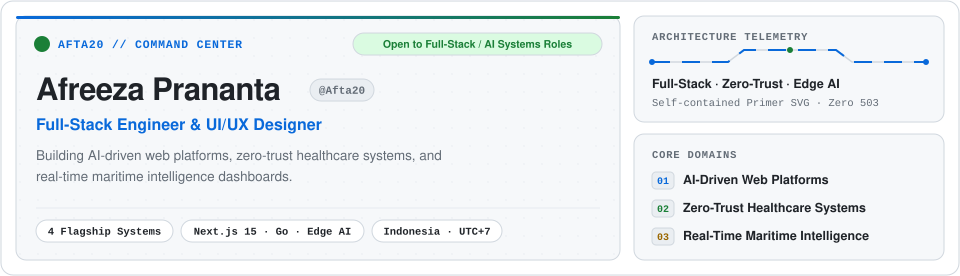
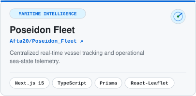
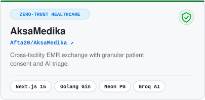
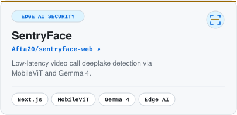
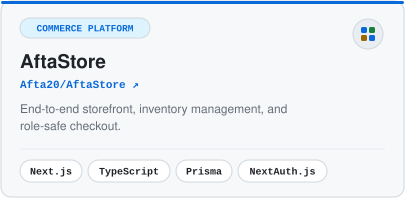
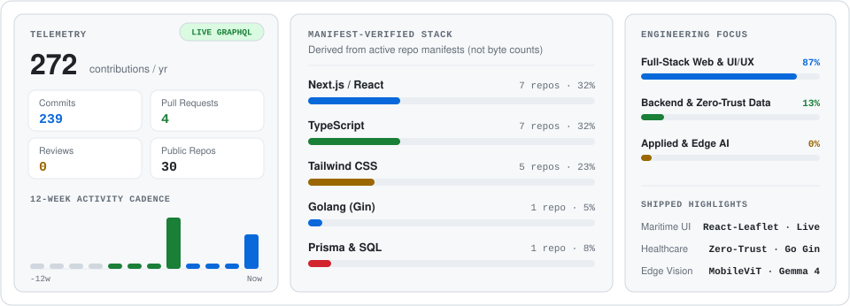

<picture>
  <source media="(prefers-color-scheme: dark)" srcset="./assets/generated/hero-dark.svg" />
  <source media="(prefers-color-scheme: light)" srcset="./assets/generated/hero-light.svg" />
  
</picture>

**Full-Stack Engineer & UI/UX Designer** building AI-driven web platforms, zero-trust healthcare systems, and real-time maritime intelligence dashboards.

> [!NOTE]
> **Quick Navigation for Engineering & Recruiting Teams:** Every system below is backed by real architecture decisions, typed data layers, and production UI workflows. Reach me directly via [LinkedIn](https://www.linkedin.com/in/afreeza-prananta/), [Portfolio](https://portofolio-afreeza.vercel.app/), or [afreezap20@gmail.com](mailto:afreezap20@gmail.com).

---

### Featured Systems

<a href="https://github.com/Afta20/Poseidon_Fleet"><picture><source media="(prefers-color-scheme: dark)" srcset="./assets/generated/project-poseidon-fleet-dark.svg" /><source media="(prefers-color-scheme: light)" srcset="./assets/generated/project-poseidon-fleet-light.svg" /></picture></a> <a href="https://github.com/Afta20/AksaMedika"><picture><source media="(prefers-color-scheme: dark)" srcset="./assets/generated/project-aksamedika-dark.svg" /><source media="(prefers-color-scheme: light)" srcset="./assets/generated/project-aksamedika-light.svg" /></picture></a>

<a href="https://github.com/Afta20/sentryface-web"><picture><source media="(prefers-color-scheme: dark)" srcset="./assets/generated/project-sentryface-dark.svg" /><source media="(prefers-color-scheme: light)" srcset="./assets/generated/project-sentryface-light.svg" /></picture></a> <a href="https://github.com/Afta20/AftaStore"><picture><source media="(prefers-color-scheme: dark)" srcset="./assets/generated/project-aftastore-dark.svg" /><source media="(prefers-color-scheme: light)" srcset="./assets/generated/project-aftastore-light.svg" /></picture></a>

---

### Telemetry & Manifest-Verified Stack

<picture>
  <source media="(prefers-color-scheme: dark)" srcset="./assets/generated/bento-dark.svg" />
  <source media="(prefers-color-scheme: light)" srcset="./assets/generated/bento-light.svg" />
  
</picture>

---

### Core Technical Capabilities

| Domain | Technologies & Architecture |
| :--- | :--- |
| **Frontend & UI/UX** | `Next.js 15 (App Router)`, `React`, `TypeScript`, `Tailwind CSS`, `React-Leaflet`, Design Systems |
| **Backend & Data** | `Golang (Gin)`, `Node.js`, `Prisma ORM`, `PostgreSQL (Neon)`, `MySQL`, `NextAuth.js` |
| **Applied & Edge AI** | `MobileViT`, `Gemma 4 Reasoning`, `Groq AI`, Low-Latency Inference Pipelines |
| **Security & Systems** | Zero-Trust EMR Consent Flows, Role-Based Access Control, Modular API Boundaries |

<strong>Architecture Notes & How This Profile Works (Self-Contained 2026 Setup)</strong>

- **Zero Third-Party Downtime:** All hero, telemetry, and project cards are compiled directly into self-contained, theme-adaptive SVG assets in `./assets/generated/` using GitHub Primer Dark (`#0d1117`) and Light (`#ffffff`) tokens.
- **Manifest-First Stack Detection:** Instead of relying on raw repository byte counts, `src/fetch_stats.py` inspects active dependency manifests (`package.json`, `go.mod`, `prisma/schema.prisma`, `pyproject.toml`) ordered by recent push activity.
- **Accessibility & Reduced Motion:** Every animated SVG starts on its finished frame for static viewers and respects `@media (prefers-reduced-motion: reduce)`.

---

### Connect

**[LinkedIn](https://www.linkedin.com/in/afreeza-prananta/)** · **[Portfolio](https://portofolio-afreeza.vercel.app/)** · **[Email (`afreezap20@gmail.com`)](mailto:afreezap20@gmail.com)** · **[GitHub (`@Afta20`)](https://github.com/Afta20)**

